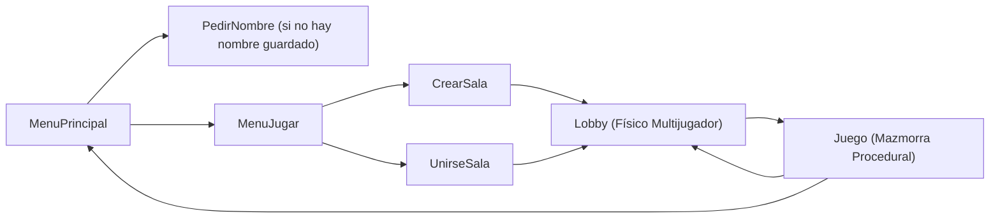

# Arquitectura Técnica del Proyecto - SoulKnight 2 ⚙️

Este documento describe la arquitectura de software, infraestructura de red, pipelines de renderizado procedural y sistemas de optimización implementados en **SoulKnight 2**.

---

## 1. Stack Tecnológico y Especificaciones

- **Motor:** Unity 2022.3.25f1 LTS (Pipeline Built-in 2D con Shaders Sprite personalizados y Pixel Art Filtering).
- **Networking:** Unity Netcode for GameObjects (NGO) versión 1.8.1.
- **Transporte de Red:** Unity Transport Package (UTP) versión 1.4.0 (Protocolo UDP).
- **Resolución y Arte:** Pixel Art nativo a **32 Pixels Per Unit (PPU)**. 1 Tile = 1x1 unidades de Unity en espacio de mundo.
- **Plataforma Objetivo:** Windows Standalone x86_64 (con portabilidad preparada para Linux/macOS y Mobile).

---

## 2. Flujo de Escenas y Ciclo de Vida

El juego opera bajo 7 escenas secuenciales configuradas en `EditorBuildSettings`:

1. **`MenuPrincipal`:** Selección de modo, opciones completas de audio y controles remapeables, consola de comandos de administración y botón de cambio de nombre (`BotonCambiarNombre`).
2. **`PedirNombre`:** Configuración inicial del alias local del jugador (`PlayerPrefs: "SoulKnight_Nombre"`).
3. **`MenuJugar`:** Selector entre Hospedar partida (`CrearSala`) o Unirse a partida (`UnirseSala`).
4. **`CrearSala` / `UnirseSala`:** Configuración de nombre de sala, contraseña opcional, código secreto alfanumérico generado (`CodigoSala.cs`) y detección LAN automática (`DescubrimientoLAN.cs`).
5. **`Lobby`:** Salón físico 2D donde los jugadores se conectan, interactúan, caminan a los recintos perimetrales para elegir o liberar su clase felina (Fuego, Hielo, Eléctrico) y cruzan el portal norte para iniciar la run.
6. **`Juego`:** Mazmorra procedural multinivel donde se ejecuta el bucle central de combate, loot, tiendas intermedias, peleas de jefes y pasajes al siguiente nivel.

---

## 3. Arquitectura de Red (Netcode for GameObjects)

SoulKnight 2 implementa un modelo **Cliente-Servidor Autoritativo** con predicción y autoridad de cliente delegada en movimiento:

### 3.1 Clases Fundamentales de Red (`Assets/Scripts/Red/`)
- **`Global.cs`:** Singleton persistente `DontDestroyOnLoad` que orquesta el `NetworkManager`, la configuración de transporte UTP, los prefabs de red registrados, los eventos de desconexión y la rutina de prueba de arranque automatizado (`-autotest`).
- **`SalaRed.cs`:** `NetworkBehaviour` singleton sincronizado que gestiona los slots de la sala (máximo 4 jugadores), nombres de clientes, estado de listos, sincronización de cambio de escena coordinado y votación de abandono de run.
- **`ClientNetworkTransform.cs`:** Transform sincronizado que otorga autoridad al cliente sobre su propio movimiento para garantizar latencia cero en el desplazamiento del jugador local.
- **`CodigoSala.cs`:** Codificación y decodificación de direcciones IP y puertos en cadenas alfanuméricas cortas estilo `SK-XXXX-XXXX` para conectarse fácilmente sin escribir IPs manuales.
- **`DescubrimientoLAN.cs`:** Emisor y receptor de broadcasts UDP en el puerto `7778` que permite listar automáticamente en la UI las partidas activas en la misma red local.
- **`UPnP.cs`:** Apertura automática de puertos en routers compatibles para facilitar partidas cooperativas a través de Internet sin necesidad de software de túneles externos.

### 3.2 Sincronización de Entidades y Estado
- **`Personaje.cs`:** Hereda de `NetworkBehaviour`. Utiliza `NetworkVariable<int>` para `VidaActual`, `VidaMaxSincronizada`, `EstaMuerto` y `NetworkVariable<FixedString64Bytes>` para el nombre sincronizado del jugador.
- **`Proyectil.cs`:** Sincronización de trayectorias autoritativas por el emisor, cálculo de daño server-side / host-side y `ClientRpc` para efectos visuales y de partículas.
- **`EnemigoBase.cs` y `JefeBase.cs`:** IA controlada exclusivamente por el Host/Servidor; las posiciones y vidas se replican a todos los clientes.

---

## 4. Pipeline de Mazmorras Procedurales y Biomas (`Assets/Scripts/Combate/`)

### 4.1 Generación de Mazmorras (`GeneradorMazmorra.cs`)
1. **Algoritmo de Colocación de Salas:** Distribución pseudoaleatoria determinista basada en semilla (`semilla`) que garantiza que todos los clientes en la sala generen exactamente la misma estructura de habitaciones y pasillos.
2. **Cuadrícula Unificada sin Desniveles:** Las baldosas de suelo y muros se instancian sobre una cuadrícula regular calculada para evitar huecos, fisuras diagonales o solapes de sprites.
3. **Sistema de Puertas Automáticas:** Al entrar el primer jugador a una sala con enemigos, las puertas se cierran automáticamente mediante colliders y muros físicos (`ControladorSala.cs`). Tras eliminar todas las oleadas, las puertas se abren y se reproduce el SFX `SalaDespejada`.
4. **Cámaras de Guardianes (Niveles sin Jefe):** En niveles pares o intermedios, la última sala no contiene un jefe sino una **oleada pesada de guardianes élite** con 6 portales mágicos periféricos.

### 4.2 Catálogo Procedural de Biomas (`CatalogoBiomas.cs`)
En lugar de depender de cientos de texturas importadas de disco que rompen compatibilidad o referencias nulas, `CatalogoBiomas` genera y cachea proceduralmente en tiempo de compilación y runtime texturas limpias en pixel art de 32x32:
- **`TipoBioma.Piedra`:** Tonos granito frío, antorchas de fuego ámbar estándar.
- **`TipoBioma.Hielo`:** Bloques de escarcha azul cian, antorchas de llama fría azulada.
- **`TipoBioma.Fuego` / `Magma`:** Basalto oscuro sin brillo cegador, charcos de lava y antorchas ígneas.
- **`TipoBioma.Planta`:** Ruinas ancestrales con musgo verde esmeralda y vegetación silvestre.
- **`TipoBioma.Arena`:** Arenisca dorada y templos desérticos.

---

## 5. Sistema de Audio Dinámico (`Assets/Scripts/Nucleo/GestorAudio.cs`)

El juego posee una arquitectura de sonido completa por código:
- **BGM Dinámico:** Música diferenciada para Menú Principal, Lobby, Mazmorra regular según el Bioma activo y música orquestal intensa durante peleas de Jefes (`MusicaJefe1`).
- **Control de Volumen Independiente:** Sliders en el menú de opciones para Master, Música y SFX, guardados de forma persistente en `PlayerPrefs`.
- **Rotación de Efectos Felinos:** El daño recibido rota aleatoriamente entre 3 variantes de quejido felino (`GatoDano1`, `GatoDano2`, `GatoDano3`) con pitch semi-aleatorio para evitar fatiga auditiva.
- **Efectos de Impacto:** SFX de impacto cortante (`Zarpazo`), escarcha (`ImpactoHielo`), ráfaga de fuego (`FuegoLlamas`), relámpago celestial (`RayoTP`, `LanzandoUltiRayo`) y consumo de pescados curativos (`ComerPescado`).

---

## 6. Optimizaciones de Rendimiento

Para garantizar 60+ FPS estables incluso en configuraciones modestas con decenas de enemigos en pantalla:
1. **Object Pooling:** Reutilización de proyectiles (`Proyectil.cs`), textos flotantes de daño (`TextoFlotante.cs`) y efectos de partículas de estado.
2. **NonAlloc Physics:** Uso de `Physics2D.OverlapCircleNonAlloc` y `Physics2D.RaycastNonAlloc` con buffers preasignados para evitar asignaciones constantes en el Garbage Collector (GC Alloc = 0 en bucles de ataque).
3. **MaterialUtil y Dynamic Instancing:** Gestión compartida de materiales para sprites de modo que no se generen duplicados de materiales por cada enemigo teñido.
4. **Throttling de Niebla y Visión (`SistemaVision.cs`):** Los cálculos de oclusión y visibilidad de luz de antorchas se calculan por pulsos distribuidos en lugar de recalcular la malla completa en cada frame.
